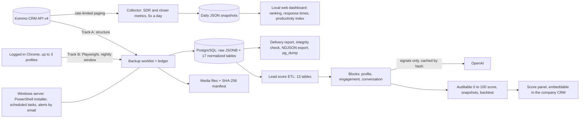

# CRM Backup and Sales Dashboards: Case Study

> Three Node.js tools around the Kommo CRM of Vale Verde Festas: an operational dashboard for the SDR and closer teams, a complete re-importable backup of every lead and WhatsApp conversation (API plus a browser session driven by Playwright), and a lead-scoring engine on PostgreSQL.
> **Source code is private.** This repository documents the project; a live walkthrough is available on request.

**Stack:** Node.js 20+, PostgreSQL 16 (raw JSONB plus normalized tables), Playwright over a logged-in Chrome, Kommo REST API v4, plain HTML/CSS/JS dashboards, nodemailer alerts, PowerShell installer and scheduled tasks for a Windows server, launchd on macOS, OpenAI for conversation signals.

**Status:** internal tooling for Vale Verde Festas, the events company where I am Head of Technology, built July to September 2026. The SDR and closer dashboard worked daily during the pilot period. The backup ran a live pilot and ships with a Windows installer audited twice; full-scale collection on the company server and the final lead-score calibration are the next stages. Not a product offered to third parties.

## Problem → Solution

**Problem.** The company runs its sales pipeline in a hosted CRM. Three gaps showed up at once: managers had no honest, per-person view of how fast SDRs answered and how many visits they booked; years of WhatsApp conversations with customers existed only inside the CRM, where the public API does not expose them, so the company owned data it could not export; and nobody could tell which open leads deserved attention first.

**Solution.** One repository with three self-contained tools that share a client for the CRM API. A collector computes the SDR and closer metrics six times a day into a dated snapshot and a local web panel shows them. A backup program copies every lead, contact, company, task, note, event, and WhatsApp message with its media into PostgreSQL, using the API where it reaches and a real browser session where it does not, with a three-layer completeness audit. A scoring engine reads that database and computes an auditable 0 to 100 score per lead, with an AI layer that only extracts signals from conversations.

## What I built

- **SDR and closer dashboard.** A collector that pages through the CRM API under its rate limits and computes, per person and per pipeline: leads received and in service, visits booked, tasks pending, late, and done, conversations handled manually versus by bot, median and mean response time, response rate, and a composite productivity index calibrated over fourteen days of real data. A small Node server serves the panel on the local network with optional password, gzip, a pipeline selector (SDR and closer funnels), light and dark themes, a color palette checked for color blindness, and a "sync now" button limited to twice a day.
- **Conversation extraction that the API does not offer.** WhatsApp history lives only behind the CRM's web session. The backup drives a logged-in Chrome with Playwright to read each conversation page by page, stopping only when the pagination link disappears (an earlier "fewer than a page means done" rule silently truncated histories), classifies message direction from a delivery field validated on 157 of 157 sampled messages, and downloads media from their public URLs directly in Node.
- **Two collection tracks, one ledger.** Track A pulls structure (leads, contacts with phones, companies, tags, notes, tasks, events, users, pipelines, field definitions) from the API; Track B pulls conversations and media through the browser. A worklist table records the state of every lead and every media file, persistence commits in a crash-safe order, a retry queue handles failed downloads, and a circuit breaker backs off on any sign of blocking.
- **Operating the backup like a job, not a script.** A nightly window (21:00 to 07:00) at a few requests per second, up to three Chrome workers each with its own logged-in profile, "daytime rounds" that re-queue errors and process batches of 10,000 leads with a progress box per batch, orphan reclaim for stuck items, and alerts on screen and by email. A monitoring panel shows KPIs, errors, a per-lead validator, and a cross-check of message counts against the API's event log.
- **Delivery that can be verified.** A delivery report with counts and an explicit "complete: yes/no" attestation, a media manifest with SHA-256 hashes, an integrity checker that re-verifies files against the manifest after a restore, an NDJSON export, and optional encryption of the package.
- **Windows installer.** A 700-line PowerShell installer registers the scheduled tasks, firewall rules, folders on the storage drive, and log protection, with a one-click launcher and an uninstaller; the collector never runs as a system account because the browser session needs an interactive desktop for two-factor login.
- **Lead score engine.** ETL from the CRM into 13 PostgreSQL tables, derived outcomes, and three deterministic blocks: profile (leakage-free, calibrated against the "visit booked" milestone rather than the sale), engagement, and conversation. The conversation block uses the backup database as its source and an OpenAI model only to extract signals, cached by content hash; the score itself is a formula that can be audited line by line. Snapshots over time feed a backtest, and the panel can be embedded in the company's own CRM as a menu item.

## Architecture

## Technical challenges

- **Exporting what the vendor does not export.** The conversation history has no public endpoint. The solution reads the same internal endpoint the web app uses, inside a real logged-in session, at a polite rate, read-only, and with the browser session kept on the company's own server. The plan sized the job from the pilot: on the order of a hundred thousand leads and over a million messages, spread across several nights.
- **Completeness you can prove.** Partial backups are worse than none because they look complete. The audit has three layers: the worklist state of every lead, a cross-check of per-lead message counts against the API's events, and a hash manifest for every media file, all summarized in a delivery report that refuses to attest completeness while any item is pending or in error.
- **Pagination and direction bugs found live.** Two rules came out of validating against real data: never stop paging on a short page, only when the "previous" link disappears; and derive direction from the delivery status field, not from the author field, which was unreliable.
- **Running unattended on a Windows machine with a browser.** Scheduled tasks under an interactive logon, three Chrome profiles that survive two-factor login, a daytime mode that ignores the nightly window until the queue drains, and an installer that was audited twice, with the findings (silent task registration failure, domain-account ACLs, an unused log protection routine) recorded for the next release.
- **A score that managers can trust.** The milestone is "visit booked", which gives more volume and an earlier signal than the final sale. Features are computed only from data available before the milestone to avoid leakage, and the AI never decides the score, it only labels conversations.

## Scale

- 3 subsystems in one repository, 24 commits between July and September 2026
- About 3,350 lines in the backup module (Node.js, SQL, PowerShell, HTML) with a 17-table schema and a 694-line installer
- About 3,060 lines in the lead score module with a 13-table schema and 20 npm commands
- About 2,850 lines in the operational dashboard (collector, server, and a 1,615-line single-file panel), 10 daily snapshots kept from the pilot period
- Pilot backup run: 107 leads, 100 contacts, 100 companies, 250 tasks, 500 notes, 7,970 events, media verified by hash
- 11 operating and design documents for the backup alone, plus about 2,960 lines of project documentation

## My role

Sole designer and developer: the metric definitions and the dashboard, the API client, the conversation extraction method and its live validation, the backup architecture (two tracks, ledger, audits, delivery), the Windows installer and its two audit rounds, the lead score data model and blocks, and the written plans the company approved before each phase.

---
Built by **Victor Sestrem** · [LinkedIn](https://www.linkedin.com/in/victor-sestrem/) · victor-sestrem@hotmail.com
